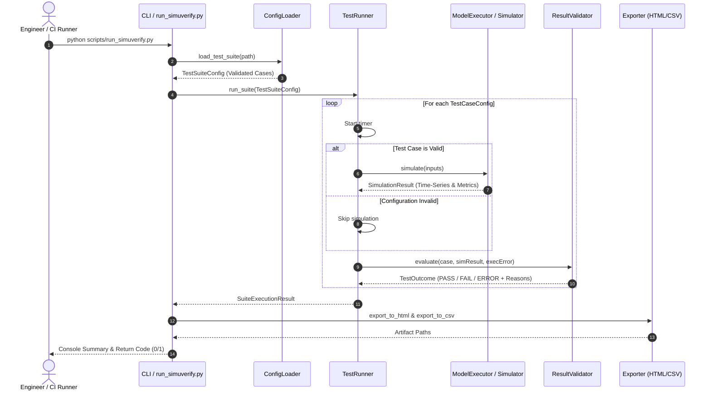
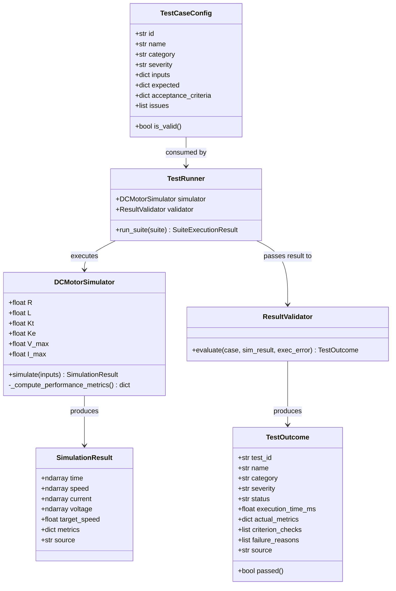

# SimuVerify: System Architecture & Design Specification

This document details the software architecture, modular boundaries, interface contracts, and execution pipelines of the **SimuVerify** validation framework.

---

## 1. System Context & Decomposition

SimuVerify decouples verification into four distinct layers:

```
+-------------------------------------------------------------------------+
|                           TEST DEFINITION LAYER                         |
|   - config/test_cases.json                                              |
|   - config/test_cases.yaml                                              |
+------------------------------------+------------------------------------+
                                     |
                                     v
+-------------------------------------------------------------------------+
|                         ORCHESTRATION LAYER                             |
|   - simuverify.runner.TestRunner (Python)                               |
|   - matlab.runner.TestRunner (MATLAB)                                   |
|   - scripts/run_simuverify.py (CLI Entry Point)                         |
+-------------------+---------------------------------+-------------------+
                    |                                 |
                    v                                 v
+---------------------------------------+ +-------------------------------+
|          EXECUTION LAYER              | |      VALIDATION LAYER         |
|  - DCMotorSimulator (RK4 ODE Engine)  | |  - ResultValidator            |
|  - dc_motor_model.m (MATLAB ODE)      | |  - Acceptance Tolerances      |
|  - run_simulink_model.m (Simulink sim)| |  - Root Cause Diagnostics     |
+-------------------+-------------------+ +---------------+---------------+
                    |                                     |
                    +------------------+------------------+
                                       |
                                       v
+-------------------------------------------------------------------------+
|                          REPORTING LAYER                                |
|   - HTML Interactive Report (embedded graphs & details)                 |
|   - CSV Summary Export (spreadsheet archival)                           |
|   - Standalone PNG Response Curves (matplotlib)                         |
|   - Streamlit Dashboard (dashboard/app.py)                              |
+-------------------------------------------------------------------------+
```

---

## 2. Sequence Diagram: Test Execution Lifecycle



---

## 3. Class Design & Separation of Responsibilities



---

## 4. Configuration Schema Specification

Test cases are declared in JSON or YAML adhering to the following schema:

```json
{
  "suite_name": "string (Required)",
  "version": "string (SemVer, e.g. 1.0.0)",
  "system_under_test": {
    "name": "string",
    "rated_voltage_v": "float",
    "rated_speed_rad_s": "float"
  },
  "test_cases": [
    {
      "id": "string (Unique ID, e.g. TC-NOM-01)",
      "name": "string (Descriptive Scenario Name)",
      "category": "nominal | boundary | fault_abnormal | invalid_config",
      "severity": "CRITICAL | MAJOR | MINOR",
      "description": "string (Detailed engineering rationale)",
      "inputs": {
        "target_speed": "float (Reference setpoint, rad/s)",
        "load_torque": "float (Disturbance torque, N*m)",
        "load_step_time": "float (Time disturbance is applied, s)",
        "sim_time": "float (Total simulation duration, s > 0)",
        "sample_time": "float (Integration step dt, s > 0)",
        "kp": "float (Proportional gain)",
        "ki": "float (Integral gain)",
        "kd": "float (Derivative gain)",
        "inertia": "float (Rotor inertia J, kg*m^2 > 0)",
        "friction": "float (Viscous damping B, N*m*s/rad)"
      },
      "expected": {
        "steady_state_speed": "float",
        "max_overshoot_pct": "float",
        "max_settling_time_s": "float",
        "max_steady_state_error": "float",
        "max_peak_current_a": "float"
      },
      "acceptance_criteria": {
        "speed_tolerance_abs": "float (Allowable |w_act - w_exp| rad/s)",
        "speed_tolerance_pct": "float (Allowable % error from target)",
        "max_overshoot_pct": "float (Maximum allowable peak overshoot %)",
        "max_settling_time_s": "float (Time to settle within 2% band)",
        "max_steady_state_error": "float (Maximum steady-state tracking error)",
        "max_peak_current_a": "float (Electrical current safety ceiling)"
      }
    }
  ]
}
```

---

## 5. Failure Categorization Matrix

| Test ID | Category | Severity | Scenario Setup | Expected Outcome | Rationale |
| :--- | :--- | :--- | :--- | :--- | :--- |
| `TC-NOM-01` | Nominal | CRITICAL | 100 rad/s step, zero load | `PASS` | Base control verification |
| `TC-NOM-02` | Nominal | MAJOR | 80 rad/s step, 0.5 N*m load at t=2s | `PASS` | Integral disturbance rejection |
| `TC-NOM-03` | Nominal | MINOR | 25 rad/s low speed, light load | `PASS` | Low-speed smooth tracking |
| `TC-BND-01` | Boundary | MAJOR | 195 rad/s near 24V saturation | `PASS` | Actuator saturation boundary |
| `TC-BND-02` | Boundary | MAJOR | 5x rotor inertia (0.05 kg*m^2) | `PASS` | Inertial payload stability |
| `TC-FLT-01` | Fault | CRITICAL | 4.5 N*m extreme stall overload | `FAIL` | Intentional failure test: catches stall & speed breach |
| `TC-FLT-02` | Fault | MAJOR | Aggressive gain Kp=35, Kd=0 | `FAIL` | Intentional failure test: catches >30% overshoot breach |
| `TC-ERR-01` | Invalid | MINOR | sim_time = -2.0 s | `ERROR` | Sanitization test: negative time |
| `TC-ERR-02` | Invalid | MINOR | Missing target_speed | `ERROR` | Schema test: missing parameter |
