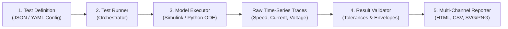

# SimuVerify: Engineering Learning Guide & Interview Preparation

> **Target Audience:** Third-Year Electronics & Communication Engineering (ECE) and Artificial Intelligence students.  
> **Topic:** Automated Testing, Model-Based Design (MBD), Dynamic Systems Validation, and CI/CD Pipelines.

---

## 1. The Big Picture: Why Model Verification Matters

In traditional software development (web, mobile), bugs might cause a button not to click or a webpage to crash. However, in **Cyber-Physical Systems (CPS)**—such as automotive Electronic Control Units (ECUs), drone flight controllers, medical infusion pumps, and electric vehicle (EV) battery management systems—a software or control glitch can cause hardware damage or endanger human life.

Industry standards such as **ISO 26262 (Automotive Functional Safety)** and **DO-178C (Aerospace Software)** mandate that requirements must be verified against implementation at every stage of the **V-Model**:

```
      REQUIREMENTS                        ACCEPTANCE VALIDATION
           \                                       /
      SYSTEM ARCHITECTURE             SYSTEM INTEGRATION (HIL)
             \                                 /
        MODEL-IN-THE-LOOP (MIL) --------> AUTOMATED VERIFICATION (SimuVerify)
               \                             /
            SOFTWARE IMPLEMENTATION (SIL)
```

### The Levels of Verification:
1. **MIL (Model-in-the-Loop):** Testing control algorithms modeled in Simulink or ODEs before generating code. This is the domain of **SimuVerify**.
2. **SIL (Software-in-the-Loop):** Compiling the generated C/C++ code into a software binary and testing it on a PC.
3. **PIL (Processor-in-the-Loop):** Running the compiled code on an actual embedded microcontroller target (e.g., ARM Cortex-M, STM32, TI C2000).
4. **HIL (Hardware-in-the-Loop):** Connecting the embedded controller to real-time physical actuators or electrical plant emulators.

---

## 2. Core Architectural Concept: Separation of Concerns

One of the most common mistakes students make in engineering projects is writing a single monolithic script that does everything:
```
% The Anti-Pattern (Tightly Coupled):
load_model;
run_simulation;
if final_speed > 95
   disp('Passed');
end
plot(tout, yout);
```

When you do this:
- You cannot change the test conditions without modifying the simulation code.
- You cannot test your validation rules without executing a slow simulation.
- You cannot run your tests in continuous integration (CI) without an expensive proprietary license.

**SimuVerify solves this using strict Separation of Concerns:**



1. **Test Definition (`config/`):** Declarative, human-readable JSON/YAML. Contains scenario requirements, inputs, expected outcomes, and numeric tolerances. Zero execution logic.
2. **Model Executor (`ModelExecutor`):** Responsible *only* for driving the model or ODE simulator. It knows nothing about pass/fail criteria.
3. **Result Validator (`ResultValidator`):** Responsible *only* for comparing numeric outputs against acceptance tolerances. It can be unit-tested completely independently with mock simulation data!
4. **Automated Reporter (`reporting/`):** Aggregates results, computes pass rates, generates time-domain response plots, and exports clean HTML and CSV validation artifacts.

---

## 3. Mathematical Foundations: The DC Motor Control System

The System Under Test (SUT) in SimuVerify is an electromechanical **DC Motor Speed Control System**. As an ECE student, this integrates your circuit theory, electromagnetics, and control engineering:

### 3.1 Armature Electrical Circuit
By Kirchhoff's Voltage Law (KVL):
$$V(t) = R \cdot i(t) + L \frac{di(t)}{dt} + e_b(t)$$

Where:
- $V(t)$ is applied armature voltage from the H-bridge / PWM amplifier (V)
- $R$ is winding resistance ($0.5\ \Omega$)
- $L$ is winding inductance ($0.02\ \text{H}$)
- $e_b(t) = K_e \cdot \omega(t)$ is the **Back-Electromotive Force (Back-EMF)** generated by the spinning rotor cutting magnetic flux lines.

Rearranging for the state derivative:
$$\frac{di(t)}{dt} = \frac{1}{L} \Big( V(t) - R \cdot i(t) - K_e \cdot \omega(t) \Big)$$

### 3.2 Rotor Mechanical Dynamics
By Newton's Second Law for rotational mechanics:
$$J \frac{d\omega(t)}{dt} + B \cdot \omega(t) = \tau_e(t) - \tau_{\text{load}}(t)$$

Where:
- $J$ is rotor moment of inertia ($0.01\ \text{kg}\cdot\text{m}^2$)
- $B$ is viscous bearing friction ($0.005\ \text{N}\cdot\text{m}\cdot\text{s/rad}$)
- $\tau_e(t) = K_t \cdot i(t)$ is developed electromagnetic motor torque
- $\tau_{\text{load}}(t)$ is external mechanical load disturbance torque

Rearranging for the angular acceleration:
$$\frac{d\omega(t)}{dt} = \frac{1}{J} \Big( K_t \cdot i(t) - B \cdot \omega(t) - \tau_{\text{load}}(t) \Big)$$

### 3.3 State-Space Formulation
We have a 2nd-order dynamic system with state vector $\mathbf{x}(t) = [i(t), \omega(t)]^T$:
$$\begin{bmatrix} \dot{i} \\ \dot{\omega} \end{bmatrix} = \begin{bmatrix} -\frac{R}{L} & -\frac{K_e}{L} \\ \frac{K_t}{J} & -\frac{B}{J} \end{bmatrix} \begin{bmatrix} i \\ \omega \end{bmatrix} + \begin{bmatrix} \frac{1}{L} & 0 \\ 0 & -\frac{1}{J} \end{bmatrix} \begin{bmatrix} V(t) \\ \tau_{\text{load}}(t) \end{bmatrix}$$

---

## 4. Acceptance Criteria: Pass vs. Fail vs. Error

A verification framework must never give a binary pass/fail without granular root-cause diagnostics. SimuVerify checks:

### 4.1 Transient & Steady-State Metrics
1. **Steady-State Speed ($\omega_{ss}$):**
   Calculated by averaging the velocity over the final $10\%$ of the simulation window.
   - Evaluated against both **Absolute Tolerance** ($|\omega_{ss} - \omega_{\text{target}}| \le \delta_{\text{abs}}$) and **Percentage Tolerance** ($\frac{|\omega_{ss} - \omega_{\text{target}}|}{\omega_{\text{target}}} \times 100\% \le \delta_{\%}$).
2. **Peak Percentage Overshoot ($M_p$):**
   $$M_p = \frac{\max(\omega) - \omega_{\text{target}}}{\omega_{\text{target}}} \times 100\%$$
   Excessive overshoot indicates insufficient damping ($\zeta < 0.707$) or aggressive derivative/proportional gains.
3. **Settling Time ($t_s$):**
   The earliest time after which the speed stays within a $\pm 2\%$ envelope of $\omega_{ss}$.
4. **Transient Peak Armature Current ($I_{\text{peak}}$):**
   $$\max |i(t)| \le I_{\text{limit}}$$
   Prevents blowing fuses or destroying MOSFET/IGBT switching transistors in the motor drive.

### 4.2 Distinguishing Test Statuses:
- **`PASS`:** Simulation executed to completion and all numeric metrics fell within acceptance bounds.
- **`FAIL`:** Simulation completed normally, but one or more engineering acceptance criteria were violated (e.g., motor stalled under load in `TC-FLT-01`, or overshoot reached $34\%$ in `TC-FLT-02`).
- **`ERROR`:** The test could not be evaluated because of malformed configuration, negative simulation duration, missing parameters, or numerical runtime divergence.

---

## 5. Dual-Mode Execution & Continuous Integration (CI)

A common challenge for students building engineering projects is:
> *"How do I demonstrate my automated testing on GitHub if GitHub Actions runners do not have a paid MATLAB license?"*

SimuVerify solves this with a **Dual-Mode Architectural Bridge**:

| Capability | Standalone CI Mode (Python Engine) | Native MATLAB Mode |
| :--- | :--- | :--- |
| **Execution Environment** | Standard GitHub Actions Linux/Windows Runner | Workstation with MATLAB R2020b+ |
| **Toolbox Requirement** | None (NumPy + standard libraries) | MATLAB core (Simulink optional) |
| **Numerical Method** | 4th-Order Runge-Kutta (RK4) ODE solver | `sim()` command or MATLAB ODE RK4 |
| **Mathematical Accuracy** | Identical state-space ODE equations | Identical state-space ODE equations |
| **Output Artifacts** | HTML report, CSV summary, PNG response plots | HTML report, CSV summary |
| **Integrity Notice** | Explicitly labelled in report banner | Explicitly labelled in report banner |

This enables you to run continuous integration on every commit for free, while having complete native MATLAB scripts ready when you present to an interviewer or professor who has MATLAB!

---

## 6. Top Interview Questions & Model Answers

### Q1: "Why did you build this project instead of just clicking 'Run' in Simulink?"
> **Model Answer:**  
> "Manual execution in GUI tools does not scale to modern engineering standards. In automotive and aerospace Model-Based Design, changes occur frequently. Automated verification ensures that every change is regression-tested against requirements without human error. Furthermore, by defining test cases in declarative configuration files (JSON/YAML) and decoupling model execution from acceptance validation, our framework can run headless in CI/CD pipelines, track failures across versions, and automatically generate audit-ready compliance reports."

### Q2: "What is the difference between a test failure and an execution error in your framework?"
> **Model Answer:**  
> "A **test failure (`FAIL`)** occurs when the system simulated properly, but violated one of the engineering acceptance limits—for example, when an intentional overload caused a motor stall (`TC-FLT-01`) or detuned PID gains caused excessive overshoot (`TC-FLT-02`). In contrast, an **execution error (`ERROR`)** occurs before or during execution when the test configuration is syntactically or physically invalid—such as a negative simulation duration (`TC-ERR-01`) or a missing required parameter (`TC-ERR-02`). Separating these prevents silent masking of configuration defects."

### Q3: "How did you ensure numerical equivalence between the Python CI engine and the MATLAB model?"
> **Model Answer:**  
> "Both implementations solve the exact same coupled differential equations governing the armature circuit ($L \dot{i} + Ri = V - K_e\omega$) and rotational mechanics ($J \dot{\omega} + B\omega = K_t i - \tau_{\text{load}}$). Both engines use 4th-Order Runge-Kutta (RK4) numerical integration with a fixed step of 1 ms and implement the same voltage saturation ($\pm 24\text{ V}$) and drive current limiter ($12\text{ A}$). This ensures deterministic, reproducible time-series traces regardless of whether the test is run in GitHub Actions or locally in MATLAB."

### Q4: "How does your framework handle actuator saturation and integrator windup?"
> **Model Answer:**  
> "When a DC motor is asked to step from 0 to 100 rad/s, the proportional error is high, which commands a voltage that exceeds the 24V supply rail. If an unconstrained integrator continues accumulating error while the actuator is saturated, the controller suffers from 'integrator windup'—leading to massive overshoot and delayed recovery. In SimuVerify, we implemented anti-windup clamping: the integrator only accumulates error if the control signal is within linear bounds or if the error sign is driving the actuator back toward the linear region."
